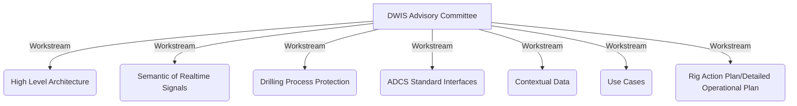
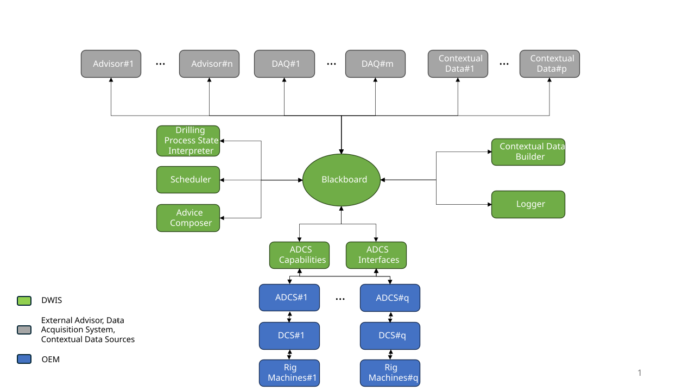

# DWIS Repository Navigator

D-WIS (Drilling and Wells Interoperability Standard) brings together specifications, semantic models, software and demonstrations for interoperable drilling systems. This navigator groups the organisation's repositories by their role: workstream documentation, Blackboard infrastructure, automation, equipment and data bridges, contextual data, and applications.

Start with the workstreams for specifications, the Blackboard repositories for semantic data exchange, and the bridge sections for connecting equipment and contextual services. Each repository's README contains its own setup and configuration instructions. **Public** repositories can be read without organisation access. **Private** repositories require explicit access; organisation membership alone may not be sufficient. Visibility labels were checked against GitHub on 29 October 2026.

## DWIS Workstreams

- [Overall](https://github.com/D-WIS/Overall/) — **Private** — An overall repo for general DWIS project documents
- [AdvisoryCommittee](https://github.com/D-WIS/AdvisoryCommittee/) — **Private** — DWIS repo for the Advisory Committee
- [HighLevelArchitecture](https://github.com/D-WIS/HighLevelArchitecture/) — **Private** — DWIS project repo for the workstream "High Level Architecture"
- [ContextualData](https://github.com/D-WIS/ContextualData/) — **Private** — The DWIS Project repo for the Workstream "Contextual Data"
- [SemanticDrillingRTSignals](https://github.com/D-WIS/SemanticDrillingRTSignals/) — **Private** — The DWIS Project repo for the Workstream "Semantic of RT Signals"
- [RigOS-DrillingProcessProtection](https://github.com/D-WIS/RigOS-DrillingProcessProtection/) — **Private** — The DWIS project repo for the workstream "Drilling Process Protection"
- [RigOSAPI](https://github.com/D-WIS/RigOSAPI/) — **Private** — The DWIS Project repo for the workstream ADCS Interfaces
- [UseCases](https://github.com/D-WIS/UseCases/) — **Private** — The DWIS Project repo for the workstream "Use Cases"
- [Downlinking](https://github.com/D-WIS/Downlinking/) — **Private** — The DWIS Project report for the specification of Downlinking commands
- [ProjectSTUPID](https://github.com/D-WIS/ProjectSTUPID/) — **Private** — A repo for working on Rig Action Plan or Detailed Operational Plan

## Main Code

### Common Code
- [Common](https://github.com/D-WIS/Common/) — **Private** — Common classes for DWIS

### Blackboard
- [DDHub-Semantic-Interoperability](https://github.com/D-WIS/DDHub-Semantic-Interoperability/) — **Public** — DWIS semantic vocabulary
- [DWIS-Blackboard-Base](https://github.com/D-WIS/DWIS-Blackboard-Base/) — **Public** — Base code for the DWIS Blackboard
- [DWIS-Blackboard-Clients](https://github.com/D-WIS/DWIS-Blackboard-Clients/) — **Private** — Clients for DWIS Blackboard
- [DWIS-Blackboard-Samples](https://github.com/D-WIS/DWIS-Blackboard-Samples/) — **Public** — Samples for the DWIS Blackboard
- [DWIS-Blackboard-Server](https://github.com/D-WIS/DWIS-Blackboard-Server/) — **Private** — DWIS Blackboard server
- [Semantic-Server-Deploy](https://github.com/D-WIS/Semantic-Server-Deploy/) — **Private** — Blackboard deployment

### Microstate Engine
- [MicroStateEngine](https://github.com/D-WIS/MicroStateEngine/) — **Public** — DWIS Microstates Engine

### Scheduler
- [Scheduler](https://github.com/D-WIS/Scheduler/) — **Private** — The original DWIS Scheduler
- [DWIS.HSM.Scheduler](https://github.com/D-WIS/DWIS.HSM.Scheduler/) — **Private** — The new version of the DWIS Scheduler compatible with autonomy

### Composer
- [AdviceComposer](https://github.com/D-WIS/AdviceComposer/) — **Public** — DWIS Advice Composer

### ADCS Interface

- [DWIS.ADCS.Interface](https://github.com/D-WIS/DWIS.ADCS.Interface/) — **Public** — .NET reference implementation of the ADCS software interface standard.

### ADCS Capability Descriptions
- [RigOS-Capabilities](https://github.com/D-WIS/RigOS-Capabilities/) — **Private** — Classes used to define the ADCS function capabilities
- [RigOS-Controller-Capabilities](https://github.com/D-WIS/RigOS-Controller-Capabilities/) — **Private** — Classes used to define the specific ADCS capabilities for Controller functions
- [RigOS-FDIR-Capabilities](https://github.com/D-WIS/RigOS-FDIR-Capabilities/) — **Private** — Classes used to define the specific ADCS capabilities for Fault Detection Isolation and Recovery
- [RigOS-Procedure-Capabilities](https://github.com/D-WIS/RigOS-Procedure-Capabilities/) — **Private** — Classes used to define the specific ADCS Capabilities for standard drilling procedures
- [RigOS-SOE-Capabilities](https://github.com/D-WIS/RigOS-SOE-Capabilities/) — **Private** — Classes used to define the specific ADCS capabilities for safe operating envelopes

- [RigOS-Service-Capabilities](https://github.com/D-WIS/RigOS-Service-Capabilities/) — **Private** — Models for discrete ADCS service actions, including WOB and differential-pressure taring and auto-driller gain tuning.

### ADCS Bridges
- [ADCSBridgeGeneric](https://github.com/D-WIS/ADCSBridgeGeneric/) — **Private** — Generic ADCS Bridge (used for BTWN)
- [ADCSBridgeDEAL](https://github.com/D-WIS/ADCSBridgeDEAL/) — **Private** — ADCS Bridge  for DEAL from HMH
- [ADCSBridgeNOVOS](https://github.com/D-WIS/ADCSBridgeNOVOS/) — **Private** — ADCS Bridge  for NOVOS from NOV

### DAQ Bridges

These bridges connect acquisition systems and the DWIS Blackboard. Most acquire vendor measurements for publication on the Blackboard; SiteCom provides the outbound path to a separate OPC-UA server. See each repository for supported signals, semantic mappings and configuration.

- [DAQBridgeCleanSight](https://github.com/D-WIS/DAQBridgeCleanSight/) — **Public** — an example bridge between the CleanSight system from DrillDocs and DWIS
- [DAQBridgeRheoSense](https://github.com/D-WIS/DAQBridgeRheoSense/) — **Public** — an example bridge between RheoSense from IMS and DWIS
- [DAQBridgeBaraLogix](https://github.com/D-WIS/DAQBridgeBaraLogix/) — **Public** — an example bridge between BaraLogix from Halliburton and DWIS
- [DAQBridgeOmniView](https://github.com/D-WIS/DAQBridgeOmniView/) — **Public** — an example bridge between OmniView from Petromar/Nabors/WellID and DWIS
- [DAQBridgeBlackStream](https://github.com/D-WIS/DAQBridgeBlackStream/) — **Private** — an example bridge between BlackStream from NOV and DWIS
- [DAQBridgeBaseStar](https://github.com/D-WIS/DAQBridgeBaseStar/) — **Public** — an example bridge between the BaseStar mechanical sub from Halliburton and DWIS
- [DAQBridgeUDPTopSideData](https://github.com/D-WIS/DAQBridgeUDPTopSideData/) — **Public** — an example bridge between a top-side logging system using UDP datagrams and DWIS
- [DAQBridgeMPDBackPressure](https://github.com/D-WIS/DAQBridgeMPDBackPressure/) — **Private** — an example bridge between a Back-pressure based MPD system and DWIS

- [DAQBridgePanorama](https://github.com/D-WIS/DAQBridgePanorama/) — **Private** — Acquires Odfjell Panorama OPC-UA measurements and publishes the selected Main-derrick signals to the Blackboard, with source logging and engineering-unit/reference conversion.
- [DAQBridgeSiteCom](https://github.com/D-WIS/DAQBridgeSiteCom/) — **Private** — Subscribes to Blackboard signals and exports them as ordinary OPC-UA variables on a separate destination server, preserving available units and provenance.

### Contextual Data

The wellbore selector establishes the active wellbore. Contextual bridges make the corresponding OSDC engineering descriptions available on the Blackboard for consuming services. JSON schemas and semantic metadata describe the exchanged documents; consult each bridge for its contract and refresh behaviour.

- [ContextualDataWellBoreSelector](https://github.com/D-WIS/ContextualDataWellBoreSelector/) — **Public** — a web application to select an active wellbore from the list of wellbores available in the OSDC microservice framework.
- [ContextualDataBridgeBHADrillString](https://github.com/D-WIS/ContextualDataBridgeBHADrillString/) — **Private** — a bridge between the OSDC BHA/Drill-string microservice and the D-WIS Blackboard
- [ContextualDataBridgeWellBoreArchitecture](https://github.com/D-WIS/ContextualDataBridgeWellBoreArchitecture/) — **Private** — a bridge between the OSDC Wellbore Architecture microservice and the D-WIS Blackboard
- [ContextualDataBridgeTrajectory](https://github.com/D-WIS/ContextualDataBridgeTrajectory/) — **Private** — a bridge between the OSDC Trajectory microservice and the D-WIS Blackboard

- [ContextualDataBridgeRig](https://github.com/D-WIS/ContextualDataBridgeRig/) — **Private** — Follows the selected wellbore, resolves its active OSDC RigJob and rig, and publishes linked RigJobDescription and RigDescription JSON documents, including job validity and WGS84 depth references.

### Displays and Operator Applications

- [DAQDisplay](https://github.com/D-WIS/DAQDisplay/) — **Private** — Read-only web display for semantically discovered Blackboard signals, with online rheometry, hydraulics, mechanics and vibration views.
- [ExplainabilityDisplay](https://github.com/D-WIS/ExplainabilityDisplay/) — **Private** — Web visualization of drilling signals, plans and decision explanations, with services for real-time data and NOVOS explainability integration.
- [ExplainabilityNOVOS](https://github.com/D-WIS/ExplainabilityNOVOS/) — **Private** — NOVOS-side operator application for reviewing proposed actions and explanations and returning operator choices through the explainability bridge.
- [DWISNOVOSApp](https://github.com/D-WIS/DWISNOVOSApp/) — **Private** — Application for the DWIS-to-NOVOS bridge.
- [DWIS.Client.Apps](https://github.com/D-WIS/DWIS.Client.Apps/) — **Public** — Standard DWIS client applications, including the Blackboard explorer.

### Advisory Development and Modelling Tools

- [DWISAdvisoryTemplate](https://github.com/D-WIS/DWISAdvisoryTemplate/) — **Public** — Starter solution for DWIS advisory services, with worker hosting, semantic input/output contracts and contextual shared-model generation.
- [DWIS.DDBot-toolkit](https://github.com/D-WIS/DWIS.DDBot-toolkit/) — **Public** — Agent skill and supporting tools for generating, modifying, validating and repairing DWIS configuration files from drilling-signal descriptions.

### Example Services
- [ServiceDownholeECD](https://github.com/D-WIS/ServiceDownholeECD/) — **Public** — a service that reads downhole annulus pressures, trajectory data and wellbore architecture information to produce Downhole ECD (and ESD).
- [ServiceActiveVolume](https://github.com/D-WIS/ServiceActiveVolume/) — **Public** — a service that reads drilling fluid and cuttings flowrate from observations at the shale shaker level and active pit volume and produces a consolidated active pit volume.
- [ServiceAdjustedWOB](https://github.com/D-WIS/ServiceAdjustedWOB/) — **Public** — a service that reads the surface and downhole WOB and that provides a consolidated WOB. The service also performs the opposite operation for recommended WOB limits, i.e., it converts into the ADCS SWOB context, WOB limits accounting for initial biases on zero WOB, effects of the block position and changes in flowrates.

- [ServiceCorrectedHookLoad](https://github.com/D-WIS/ServiceCorrectedHookLoad/) — **Private** — Corrects hook-load measurements for sensor location and hoisting-system motion using sensor fusion, then publishes the corrected hook load on the Blackboard.

## Installation and Interface Specifications

- [DWISDeepseaStavanger](https://github.com/D-WIS/DWISDeepseaStavanger/) — **Private** — Installation and integration preparation for DWIS on Deepsea Stavanger, including the OpenLab test environment.
- [RSS-Communication](https://github.com/D-WIS/RSS-Communication/) — **Private** — Interface specifications for rig-site and remote RSS downlinking over REST, WebSocket and AMQP; contains API contracts and rendered documentation.

## Additional Code for Demo Preparation
- [DWIS-demo-2024-deploy](https://github.com/D-WIS/DWIS-demo-2024-deploy/) — **Private** — Repository used for the deployment of the apps involved in the 2024 D-WIS demonstration
- [DWIS-demo-2024-openlab](https://github.com/D-WIS/DWIS-demo-2024-openlab/) — **Private** — The applications used during the preparation of the 2024 DWIS demonstration
- [DWIS-demo-2024-openlab-adcs](https://github.com/D-WIS/DWIS-demo-2024-openlab-adcs/) — **Public** — The DWIS to OpenLab drilling access used during the preparation of the 2024 DWIS demonstration
- [DWIS-demo-2024-openlab-replay](https://github.com/D-WIS/DWIS-demo-2024-openlab-replay/) — **Private** — A repository used to perform replays
- [DWIS-demo-2024-web](https://github.com/D-WIS/DWIS-demo-2024-web/) — **Private** — The DWIS web interface used during the 2024 DWIS demonstration
- [DWIS-demo-mockup](https://github.com/D-WIS/DWIS-demo-mockup/) — **Private** — Repository to perform mockup tests in connection to preparation of DWIS Demos
- [DWIS-Docker](https://github.com/D-WIS/DWIS-Docker/) — **Public** — Facilities for D-WIS containers management
- [DWIS-NOVOS-Clients](https://github.com/D-WIS/DWIS-NOVOS-Clients/) — **Private** — Clients for the DWIS NOVOS bridge
- [eRAPAdvisor](https://github.com/D-WIS/eRAPAdvisor/) — **Private** — an eRAP Advisor

## Additional Code for Side and Obsolete Projects
- [ADCSSoftwareInterface](https://github.com/D-WIS/ADCSSoftwareInterface/) — **Private** — OpenRDM
- [RigOS-Viewer-Capabilities](https://github.com/D-WIS/RigOS-Viewer-Capabilities/) — **Private** — A viewer for ADCS Capabilities
- [WP2_CSI](https://github.com/D-WIS/WP2_CSI/) — **Private** — Repo for the CSI application. Part of the work package 2 of the DSID project
- [WP2_MUMA](https://github.com/D-WIS/WP2_MUMA/) — **Private** — Repo for the mud management activity. Work package 2 of the DSID project
- [D-WIS.github.io](https://github.com/D-WIS/D-WIS.github.io/) — **Public** — The first web page for the DWIS project. Now replaced by [D-WIS.org](https://d-wis.org/)

## Archived and Deprecated
- [SemanticAndLogicalStatement](https://github.com/D-WIS/SemanticAndLogicalStatement/) — **Private** — Classes used to define semantically logical statements
- [SemanticAndStateAutomata](https://github.com/D-WIS/SemanticAndStateAutomata/) — **Private** — Classes used to define semantically finite State Automata
- [DDHub-DSID-WP2-Common](https://github.com/D-WIS/DDHub-DSID-WP2-Common/) — **Private** — Many test projects used during development

# Publications
- Cayeux, Eric, Macpherson, John, Laing, Moray, Pirovolou, Dimitrios, and Fred Florence. "Drilling Systems Automation: Fault Detection, Isolation and Recovery Functions for Situational Awareness." Paper presented at the SPE/IADC International Drilling Conference and Exhibition, Stavanger, Norway, March 2023. [SPE-212565-MS](https://doi.org/10.2118/212565-MS)
- Cayeux, Eric, Macpherson, John, Pirovolou, Dimitrios, Laing, Moray, and Fred Florence. "A General Framework to Describe Drilling Process States." Paper presented at the SPE/IADC International Drilling Conference and Exhibition, Stavanger, Norway, March 2023. [SPE-212537-MS](https://doi.org/10.2118/212537-MS)
- Cayeux, Eric, Daireaux, Benoît, Macpherson, John, Florence, Fred, and Espen Solbu. "Interoperability of Real-Time Drilling Signals at the Rig Site: An Example Based on Mechanical Specific Energy." Paper presented at the SPE/IADC International Drilling Conference and Exhibition, Stavanger, Norway, March 2023. [SPE-212472-MS](https://doi.org/10.2118/212472-MS)
- Annaiyappa, P., Macpherson, J., and E. Cayeux. "Clock Synchronization and Timestamping of Data on Acquisition at the Wellsite: Guidelines and Recommendations." SPE Drill & Compl (2023;): [SPE-208732-PA](https://doi.org/10.2118/208732-PA)
- Kuilenburg, R. Van, Isbell, M., Behounek, M., Macpherson, J., Schaefer, S., Fox, T., and D. Pirovolou. "Interoperability for Drilling Process Automation." Paper presented at the IADC/SPE International Drilling Conference and Exhibition, Galveston, Texas, USA, March 2024. [SPE-217748-MS](https://doi.org/10.2118/217748-MS)
- Cayeux, Eric, Macpherson, John, Pirovolou, Dimitrios, Laing, Moray, and Fred Florence. "A General Framework to Describe Drilling Process States." SPE Journal (2024;): [SPE-212537-PA](https://doi.org/10.2118/212537-PA)
- Cayeux, E., Daireaux, B., Olsen, K. K., Antosz, K., Johansen, M. Dahle, Næsgaard, H. S., and L. Hoarau. "Demonstration of Seamless Interoperability for Automatic Drilling Management in a Multi-Vendor Context." Paper presented at the SPE Annual Technical Conference and Exhibition, New Orleans, Louisiana, USA, September 2024. [SPE-220987-MS](https://doi.org/10.2118/220987-MS)
- Cayeux, E., Macpherson, J., Brackel, H. U., Igland, J. K., and S. Schaefer. "Automatic Online Classification of Drilling Activities." Paper presented at the SPE/IADC International Drilling Conference and Exhibition, Stavanger, Norway, March 2025. [SPE-223782-MS](https://doi.org/10.2118/223782-MS)
- Cayeux, E., Mihai, R., Herikstad, R. V., Olsen, K. K., Antosz, K., and M. Pham. "Code Generation of Automatic Drilling Control System Functions with Embedded Verification and Validation Functionalities." Paper presented at the SPE/IADC International Drilling Conference and Exhibition, Stavanger, Norway, March 2025. [SPE-223716-MS](https://doi.org/10.2118/223716-MS)
- E. Cayeux, B. Daireaux, E. Dvergsnes, I. Villanueva, M. Pham, K.K. Olsen, S. Gåseland, K. Antosz, D. Dashevskiy, R. Tobisawa, F. da Silva, R. Herikstad, K. Birgisson, E. Nyjordet, and J. Cao. “Demonstration of the Drilling and Wells Interoperability Standard Framework in a Multi-Company Context”, SPE/IADC Drilling Conference, Galveston, TX, USA, Mar 2026
